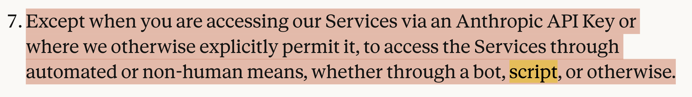
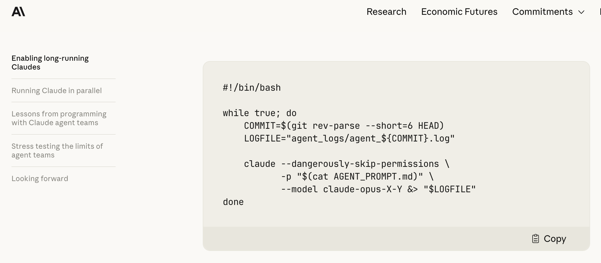

# Agentic Programming: Recent AI Usage and Local Optimization
## Long-Running Agents, CSE, and DCE

Jian Weng  
CEMSE, KAUST  
Week 14, Session 1

---

# Today's Agenda

1. A recent lightweight AI workflow
2. Why long-running agents are useful but risky
3. Why paper writing still needs heavy human involvement
4. Return to compiler optimization
5. Common sub-expression elimination
6. Dead code elimination

---

# My Recent AI Usage

I talked about many AI flows in the last few months.

Then I realized:

- many of them are too heavyweight to start
- the activation energy is too high
- sometimes I just need a small loop

So recently I use something much simpler.

---

# The Small Loop

```bash
while [ there is uncleared item in todo.md ]; do
  codex exec "look at todo.md and try to resolve it"
done
```

The idea:

- keep the task state in `todo.md`
- let the agent pick the next unfinished item
- repeat until the file says the goal is done

---

# Be Careful With Automation

This style is powerful, but it also enters policy and terms-of-service territory.

<div class="center">

</div>

The technical pattern is simple.
The operational permission is not always simple.

---

# Long-Running Agents

<p class="zh">只许州官放火，不许百姓点灯</p>

The man in power can do whatever he wants, but the commons could only obey.

<div class="center">

</div>

---

# What the Loop Actually Buys

The loop is not magic intelligence.

It mainly buys:

- persistence
- retry
- progress tracking
- less human context switching

That is already enough to change how programming feels.

---

# The Bedtime Wish Pattern

I feel less motivated to do some research chores manually nowadays.

Sometimes I make a wish to AI before going to bed:

```text
- [ ] Look at this file to seek a fix.
- [ ] Try this direction to see if it is promising.
```

Sometimes the result is useful.
Sometimes the wish does not come true.

---

# When Wishes Fail

The homework I left you last week is a good example.

An overnight agent can fail because:

- the goal is underspecified
- the codebase has hidden constraints
- tests are missing or expensive
- the agent cannot tell when the result is actually good

Long-running does not mean self-correcting.

---

## Objective

- make this test pass
- convert this file format
- implement this API contract
- remove these diagnostics

## Subjective

- make it better
- write a stronger paper
- improve the argument
- make the style more academic

---

# Paper Writing Is Different

Paper writing should still be highly human-involved.

Why?

- AI tends to be people-pleasing
- subjective goals invite generic expansion
- more details can make the paper worse
- academic writing often needs deletion, not accumulation

For papers, length is not the same as quality.

---

# Why Paper Overhead Hurts More Now

Before:

- half a year of implementation
- two weeks of paper writing

Now:

- two weeks of implementation
- two weeks of paper writing

The writing overhead becomes a much larger fraction of the project.

---

# Fixed Overhead

Paper writing is a fixed overhead around building things.

AI reduces implementation time first.

That means:

- implementation becomes cheaper
- evaluation and writing become the bottleneck
- research process design matters more

The bottleneck moves.

---

# Back to Compiler Stuff

Now we return to optimization.

So far we have discussed:

- AST
- semantic checking
- IR
- SSA intuition
- ownership and correctness

Today we add two classic optimization passes.

---

# Local Optimization

We will focus on optimizations that are easy to explain on basic blocks.

Two examples:

1. **Common sub-expression elimination**
2. **Dead code elimination**

Both are about avoiding useless work.

One removes repeated computation.
The other removes unused computation.

---

# Common Sub-Expression Elimination

Common sub-expression elimination, or CSE, removes repeated expressions.

Source idea:

```rust
let x = (a + b) * c;
let y = (a + b) * d;
```

The expression `a + b` appears twice.

If `a` and `b` do not change, compute it once.

---

# CSE in Three-Address Code

Before:

```text
t1 = a + b
x  = t1 * c
t2 = a + b
y  = t2 * d
```

After:

```text
t1 = a + b
x  = t1 * c
y  = t1 * d
```

`t2` becomes unnecessary.

---

# Why IR Makes CSE Easier

The source code may hide repeated work inside nested syntax.

IR makes it explicit:

```text
dest = src1 op src2
```

Then the compiler can ask:

- have I already seen this operation?
- are the operands the same?
- are the operand values still valid?

---

# CSE Is About Value Equality

This is safe:

```text
t1 = a + b
x  = t1 * c
t2 = a + b
y  = t2 * d
```

This is not the same:

```text
t1 = a + b
a  = a + 1
t2 = a + b
```

The expression text is the same, but the value may be different.

---

# Basic-Block CSE

Inside one basic block:

```text
t1 = a + b
t2 = t1 * 3
t3 = a + b
t4 = t3 * 5
```

We can keep a table:

```text
(add, a, b) -> t1
```

When `(add, a, b)` appears again, reuse `t1`.

---

# CSE and Side Effects

CSE is safe for pure expressions.

Be careful with operations that may have side effects:

```text
t1 = read()
t2 = read()
```

These are not common sub-expressions.

Even if the operation text is the same, each call may produce a new value.

---

# Dead Code Elimination

Dead code elimination, or DCE, removes computations that do not affect output.

Example:

```text
t1 = a + b
t2 = t1 * 4
return t1
```

`t2` is dead.

It is computed, but no later instruction uses it.

---

# DCE Example

Before:

```text
t1 = a + b
t2 = t1 * 4
t3 = t1 - 1
print t3
return t3
```

After:

```text
t1 = a + b
t3 = t1 - 1
print t3
return t3
```

The compiler deletes `t2 = t1 * 4`.

---

# Liveness Intuition

A value is **live** if it may be used later.

Work backward:

```text
t1 = a + b
t2 = t1 * 4
t3 = t1 - 1
return t3
```

- `t3` is live because of `return`
- `t1` is live because `t3` uses it
- `t2` is not live

---

# Side Effects Matter Again

This looks unused:

```text
t1 = call foo()
return 0
```

But the call may:

- print
- mutate memory
- read input
- throw an error

So DCE can remove unused pure computation, but not arbitrary effects.

---

# CSE Can Enable DCE

Before CSE:

```text
t1 = a + b
x  = t1 * c
t2 = a + b
y  = t2 * d
```

After CSE:

```text
t1 = a + b
x  = t1 * c
y  = t1 * d
```

CSE makes `t2` dead, then DCE removes it.

---

# Pass Pipeline

A simple optimizer can be structured as repeated passes:

```text
parse
  -> semantic check
  -> lower to IR
  -> CSE
  -> DCE
  -> code generation
```

In a real compiler, these passes may run more than once.

One pass creates opportunities for another pass.

---

# Why This Matters for Your Compiler

Optimization is not just clever rewriting.

It needs:

- explicit IR
- clear side-effect rules
- value-use tracking
- tests that compare program behavior

Your compiler should first be correct.
Then it can become fast.

---

# Takeaways

- Lightweight loops make agents easier to start
- Long-running agents need explicit goals and safety boundaries
- Subjective writing remains a human-heavy task
- CSE removes repeated pure computation
- DCE removes unused pure computation
- IR is where these compiler ideas become practical
