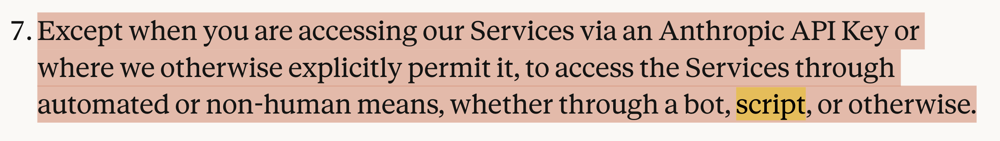
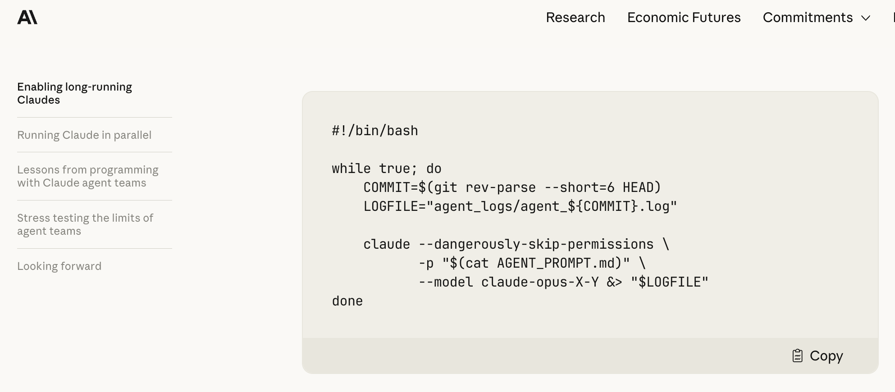

# My Recent AI Usage

I talked about so many AI flows in the last few months.
But then I realize they are still to heavy-weighted for me to kick off.
I now do it really simple:

````bash
while [ there is uncleared item in todo.md ]; do
  codex exec "look at todo.md and try to resolve it"
done
````

But be careful, it may violates the term of services and use of Claude.




----

I feel so de-motivated to do research nowadays.
I just make a wish to AI before going to bed, and I wish I could see the results in the morning.
But wishes do not always come true, e.g. the homework I left you last week.

----

Further, I found some wishes should not be made before going to bed, e.g. paper writing.
AI is people-pleasing personality.
When you have a wish that is objective, it is good.
When you have a wish that is subjective, AI is going to achieve it in the way it thinks it pleases you the most.
It makes the paper longer and longer with more and more details, which is not the correct academic paper writing style.
It bloats the paper.

----

Paper writing you should still need to be highly human-involved.
But why do we care about papers nowadays?
- Before, we spent half a year of implementation, and 2 weeks for paper writing.
- Now, we spent two weeks for implementation, and 2 weeks for paper writing.
Paper writing is a fixed overhead, which hurts building things.

----

Then we talk about more about the compiler stuff.

- Common sub-expression elimination.
  - Give an example of common sub-expression elimination.

- Dead code elimination.

